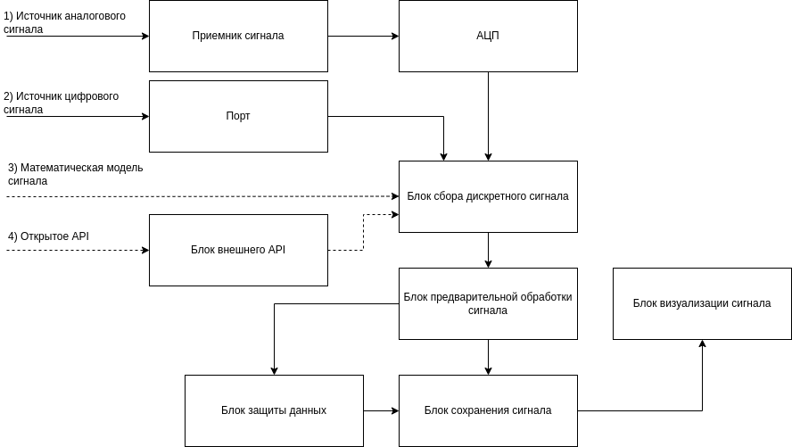
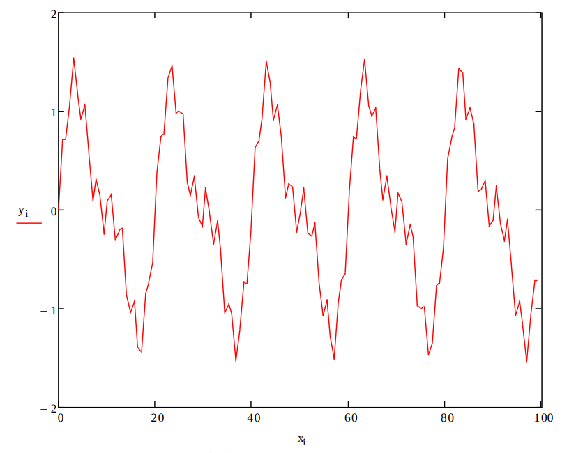
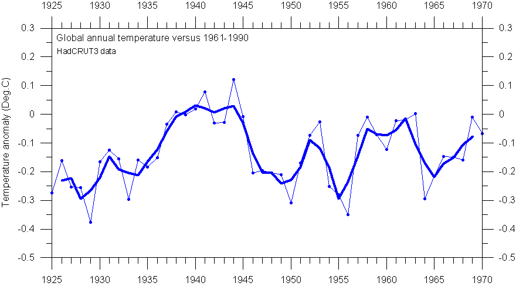
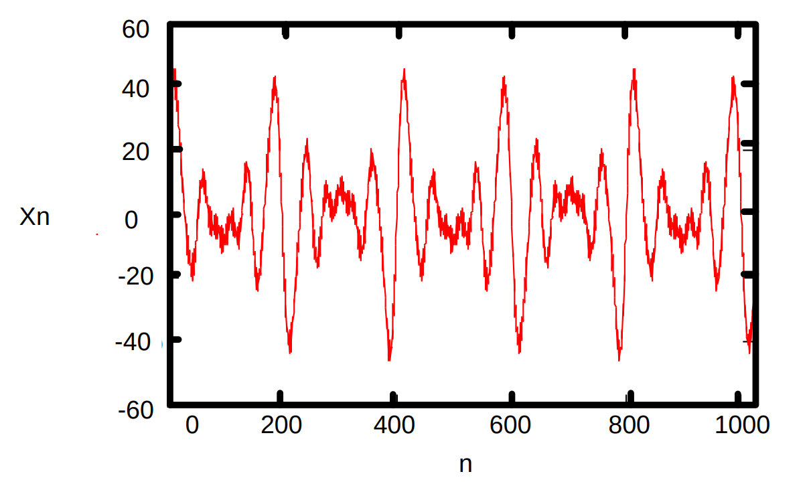
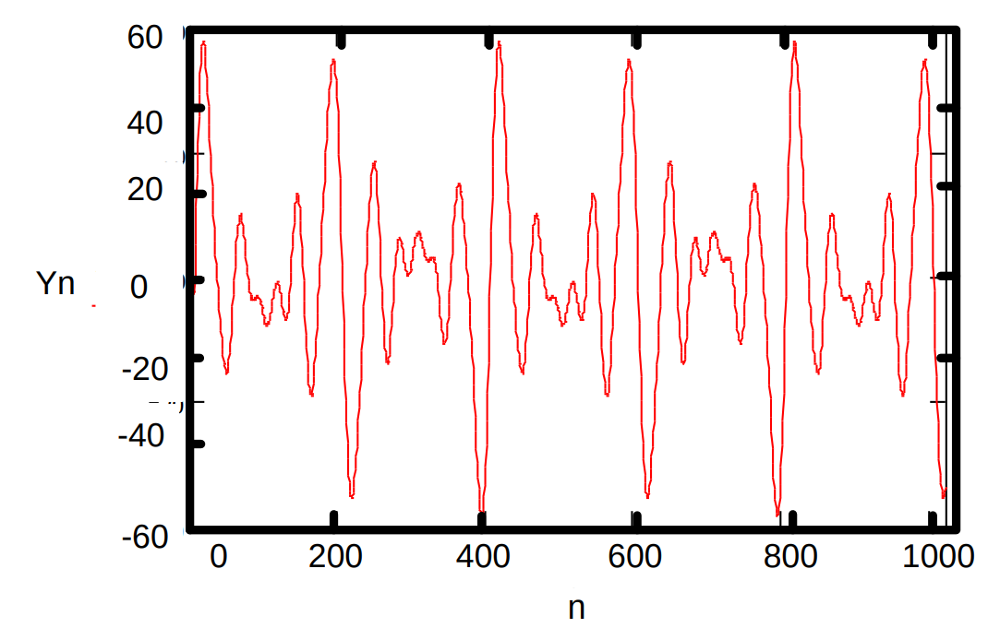
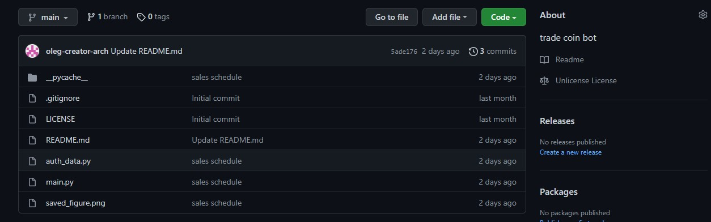
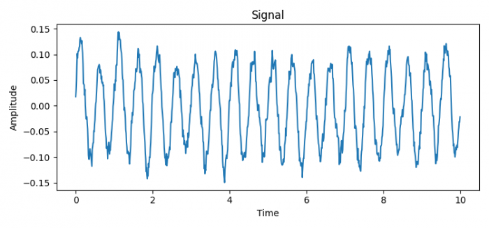
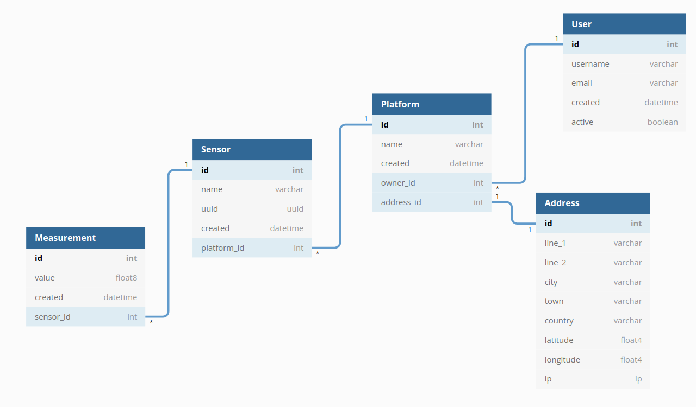

# Лабораторные работы: содержание, цели и требования

Дисциплина: **«Программное и аппаратное обеспечение информационных систем»**.

Источник: `Лабораторные работы.docx`, «Учебно-методическое обеспечение дисциплины», Минобрнауки России, ФГАОУ ВО «Южный федеральный университет», Ростов-на-Дону — Таганрог, **2022**.

Назначение этого файла — сохранить содержание методички в удобном для работы Markdown, чтобы при проектировании и выполнении лабораторных не требовалось заново открывать DOCX. Сохранены цели, результаты обучения, теория, все пункты заданий, варианты, формулы, примеры кода, структура БД, рекомендации по инструментам, иллюстрации и оценивание. Повторяющиеся организационные положения объединены в общие разделы.

> **Как читать требования.** Разделы «Обязательные пункты задания» передают задания методички; условие «если необходимо» сохранено. «Рекомендуемые инструменты» и «Пример из методички» не означают обязательный выбор конкретного продукта или темы. Чек-листы результатов — рабочая раскладка заданий для самопроверки, а не дополнительная официальная шкала оценивания. Редакторские пояснения и неточности исходника явно отмечены.

## Содержание

1. [Общая задача и последовательность работ](#общая-задача-и-последовательность-работ)
2. [Общие условия, средства и организация](#общие-условия-средства-и-организация)
3. [ЛР № 1. Проектирование с CASE-средствами](#лр-1-проектирование-с-case-средствами)
4. [ЛР № 2. Разработка программной части](#лр-2-разработка-программной-части)
5. [ЛР № 3. Аппаратная часть или её модель](#лр-3-аппаратная-часть-или-её-модель)
6. [ЛР № 4. Защита и хранение данных](#лр-4-защита-и-хранение-данных)
7. [Оценивание всех работ](#оценивание-всех-работ)
8. [Итоговая проверка проекта](#итоговая-проверка-проекта)
9. [Неопределённости и неточности методички](#неопределённости-и-неточности-методички)
10. [Иллюстрации исходного документа](#иллюстрации-исходного-документа)

---

## Общая задача и последовательность работ

### Единый проект для ЛР № 1–4

В общем случае студенту предлагается разработать **систему приёма данных от аппаратного источника с предварительной обработкой, сохранением в базу данных и защитой информации**.

Это общее задание. Частная реализация зависит от варианта, желания и возможностей студента. Все четыре работы развивают одно комплексное приложение или аппаратно-программную платформу.

| Работа | Основное содержание |
| --- | --- |
| № 1 | Выбрать идею и источник данных, сформировать требования и документацию, построить схемы, определить модули и структуру БД, запланировать этапы и задачи |
| № 2 | Реализовать приём данных, буфер, дискретизацию/синхронизацию выборки, предварительную обработку; создать интернет-репозиторий |
| № 3 | Использовать или моделировать аппаратный блок обработки и защиты, доработать приём и обработку; для математической модели имитировать дискретизацию и квантование; построить график |
| № 4 | Спроектировать и создать БД, связать несколько таблиц, реализовать слой доступа, защиту, запись и чтение обработанных данных |

### Допустимые источники данных

Идеальный аппаратный вариант в методичке — комплекты разработчика:

- Arduino;
- Raspberry Pi;
- STM SDK — именно такое обозначение дано в документе.

Однако отсутствие платы, средств на её приобретение или знаний аппаратного программирования и цифровой схемотехники **не исключает выполнение работ**. Прямо разрешена эмуляция получения входных данных:

1. Математической моделью сигнала.
2. Файлами или базой данных с отсчётами/измерениями.
3. Внешними сетевыми API из открытых источников.

В перечнях уточнения схемы для ЛР № 2 и № 3 отдельно названы:

- аппаратный аналоговый датчик;
- аппаратный цифровой датчик;
- математическая модель датчика с генератором цифрового сигнала;
- внешнее API в Интернете.

Файлы и БД в этих коротких перечнях не повторены, но разрешены в пояснениях методички. Не требуется одновременно реализовывать все перечисленные источники.

### Общая схема из методички



В изображении перечислены следующие блоки:

- приёмник сигнала;
- порт;
- АЦП;
- блок внешнего API;
- блок сбора дискретного сигнала;
- блок предварительной обработки сигнала;
- блок визуализации сигнала;
- блок защиты данных;
- блок сохранения сигнала.

Это общая иллюстрация архитектуры. Конкретный тракт зависит от источника: наличие в схеме АЦП или внешнего API не означает, что оба блока обязательны в каждой реализации.

---

## Общие условия, средства и организация

### Оснащение и программные средства

Для всех занятий методичка предполагает аудиторию со следующим оснащением:

- комплект персональных ЭВМ в компьютерном классе с выходом в Интернет;
- мультимедийная доска для демонстрации материалов;
- ОС Windows или Linux;
- текстовый редактор MS Office или Libre Office;
- редактор графических схем типа Draw.io.

Дополнительно для **ЛР № 2, № 3 и № 4**:

- средства разработки нативного или кроссплатформенного ПО;
- язык по выбору студента: JavaScript, Python, Pascal, C++, C# или Java.

Дополнительно для **ЛР № 4**:

- локальная база данных: сервер БД либо просто драйвер SQLite3.

> **Пояснение:** перечисление Windows/Linux и оснащения аудитории приведено в разделе условий проведения занятий. Методичка не формулирует отдельного запрета на выполнение проекта в macOS, но и явно не описывает такой сценарий. При необходимости требования к среде сдачи нужно уточнить у преподавателя.

### Рекомендуемые инструменты для всех четырёх работ

| Назначение | Рекомендация исходника | Допустимость замены |
| --- | --- | --- |
| Облачный документооборот и комплект документации | OneDrive или Google Drive | Выбор может быть изменён студентом |
| Структурные, функциональные, UML-схемы | Draw.io: отдельное приложение, онлайн-ресурс или расширение Google Drive | Назван как рекомендуемый бесплатный инструмент |
| Структура БД | dbdiagram.io или StarUML | Названы как предлагаемые инструменты |
| Управление проектом и задачами | Бесплатный вариант JIRA или аналоги, например Trello | Аналоги прямо разрешены |
| Удалённый репозиторий кода | GitHub или GitLab | В задании требуется интернет-репозиторий, а эти платформы приведены как примеры |
| Локальная работа с репозиторием | Git | Методичка напоминает о необходимости установленного Git; для Windows — отдельная установка |

Упоминания бесплатности и доступных вариантов относятся к тексту методички 2022 года и не являются проверкой текущих тарифов сервисов.

Текущие локальные Markdown-файлы сами по себе не означают, что выполнены требования об облачном документообороте и оформлении задач в системе управления проектами: эти действия нужно выполнить отдельно выбранными средствами.

### Методика проведения каждого занятия

Одинакова для ЛР № 1–4:

1. Рассмотрение теоретических вопросов.
2. Разъяснения преподавателя.
3. Диспут или круглый стол по тематике занятия.
4. Выполнение заданий преподавателя.
5. Анализ и оценка выполненных работ и степени освоения запланированных компетенций.

---

<a id="лр-1-проектирование-с-case-средствами"></a>

## ЛР № 1. Проектирование с CASE-средствами

**Полное название:** «Применение CASE-средств для проектирования и разработки программного и аппаратного обеспечения ИС и АС».

### Цель

Изучить виды и типы CASE-средств поддержки процесса разработки программного обеспечения, освоить принципы их практического применения, выбрать тему и реализовать первую часть индивидуального проекта.

### Заявленный результат

Студент получает **комплект документации и схемы программного обеспечения, выполненные при помощи CASE-средств**.

### Что нужно знать и уметь

**Знать:**

- классификацию CASE-средств и основы их применения;
- современные инструменты поддержки разработки ПО, относящиеся к CASE-средствам.

**Уметь:**

- применять CASE-средства поддержки разработки ПО на практике.

### Теоретическое содержание

1. Основные группы CASE-средств.
2. CASE-средства верхнего уровня.
3. CASE-средства нижнего уровня.
4. Интегрированные CASE-средства.
5. Факторы выбора CASE-средств.
6. Методологии разработки программных проектов.
7. CASE-средства проектирования ПО.
8. CASE-средства проектирования БД.
9. CASE-средства управления проектами и ролями пользователей.
10. CASE-средства моделирования.
11. Инструменты документирования проектов.
12. Основы применения UML-диаграмм.
13. Инструменты построения UML-диаграмм.

### Обязательные пункты задания

- [ ] **ЛР1-01. Сформировать идею** для серии ЛР № 1–4: комплексное приложение или аппаратно-программную платформу.
- [ ] **ЛР1-02. Выделить основные технические требования** к разрабатываемому приложению.
- [ ] **ЛР1-03. Оформить идею и технические требования в системе облачного документооборота**, сформировав комплект документации.
- [ ] **ЛР1-04. Разработать структурную схему приложения** с применением CASE-средств.
- [ ] **ЛР1-05. Разработать функциональную схему приложения** с применением CASE-средств.
- [ ] **ЛР1-06. Сформировать структуру модулей приложения** с применением CASE-средств и UML-диаграмм.
- [ ] **ЛР1-07. Сформировать структуру базы данных приложения** с применением CASE-средств и UML-диаграмм.
- [ ] **ЛР1-08. Определить этапы разработки и составить список решаемых задач.**
- [ ] **ЛР1-09. Оформить список задач в системе управления проектами.**

### Выбор источника и математическая модель

На этом этапе выбирают способ получения данных. Физические комплекты и допустимые замены перечислены в общем разделе.

Для математической генерации методичка предлагает **аддитивную модель суммы гармонических сигналов** с разными амплитудами и частотами.

Формула **в исходной записи**:

```text
X = A1*sin(2*pi*F1) + A2*sin(2*pi*F2) + … + Ak*sin(2*pi*Fk).
```

- `A` — вектор амплитуд гармоник.
- `F` — вектор частот гармоник.
- Длины `A` и `F` одинаковы и равны `k`.
- Наложение гармоник разной силы и частоты позволяет получать разные формы сигнала.

В исходнике далее дан пример с зависимостью от отсчёта `x_i`. В обычной математической записи:

```text
y_i = sin(2π · 0.05 · x_i)
    + 0.5 · sin(2π · 0.1 · x_i)
    + 0.25 · sin(2π · 0.4 · x_i).
```



Имея дискретные значения, получают симуляцию внешнего источника и процесса дискретизации; на выходе — массивы цифровых данных для следующих этапов системы.

> **Редакторское пояснение:** в первой общей формуле пропущена переменная времени/отсчёта. Для изменяющегося сигнала её необходимо задать, как это сделано в следующем примере. Сумма фиксированных синусоид сама по себе детерминирована, хотя исходник называет её имитацией источника случайных сигналов. Случайный шум — отдельное возможное дополнение, а не обязательный пункт этой работы. Числа из примера ЛР № 1 не заменяют таблицу вариантов ЛР № 2.

### Результаты для самопроверки

По заданию должны быть подготовлены:

- выбранная идея сквозного проекта и способ получения данных;
- перечень технических требований;
- комплект документов в выбранной облачной системе;
- отдельные структурная и функциональная схемы;
- UML-структура модулей;
- структура БД;
- этапы разработки и задачи;
- список задач в системе управления проектами.

Методичка не называет конкретные типы UML-диаграмм и не устанавливает шаблон технического задания. Нельзя без дополнительных указаний считать, например, диаграммы классов, последовательностей и прецедентов одновременно обязательными.

---

<a id="лр-2-разработка-программной-части"></a>

## ЛР № 2. Разработка программной части

**Полное название:** «Разработка программной части ИС и АС».

### Цель

Изучить методы сопровождения исходного кода, создания и использования репозиториев, получения сигналов и данных, предварительной обработки информации до применения бизнес-логики приложения.

### Заявленный результат

Студент получает навыки:

- создания репозиториев исходного кода;
- приёма данных;
- написания программ предварительной обработки принятых данных.

### Что нужно знать и уметь

**Знать:**

- способы современной разработки ПО нативными или кроссплатформенными инструментами;
- современные CASE-средства поддержки разработки ПО.

**Уметь:**

- применять CASE-средства разработки ПО;
- применять нативные и кроссплатформенные инструменты разработки.

### Теоретическое содержание

1. Нативные программные средства, инструменты и библиотеки.
2. Кроссплатформенные программные средства, инструменты и библиотеки.
3. Принципы выполнения программного кода на уровне микропроцессора ЭВМ.
4. Способы компиляции программ.
5. Принципы работы компиляторов.
6. Принципы работы интерпретаторов скриптовых языков.
7. Способы кросскомпиляции приложений.
8. Использование виртуальных машин и виртуализации при разработке ПО.
9. Технология работы с языком Си.
10. Технология работы с языком Pascal.
11. Технология работы с веб-стеком для разработки ПО.
12. Технология работы со стеком Java.
13. Технология работы со стеком C#.
14. Типовая структура проекта.
15. Использование систем контроля версий для управления проектами.

### Общая постановка

Разработать программную реализацию приёма данных от аппаратного источника **или его модели**, предварительно обрабатывающую полученные данные. В ЛР № 1 способ получения выбирали; в ЛР № 2 блок приёма уже нужно реализовать.

### Обязательные пункты задания

- [ ] **ЛР2-01. Доработать задание ЛР № 1, если это необходимо.**
- [ ] **ЛР2-02. Доработать структурную схему программного обеспечения, если это необходимо.**
- [ ] **ЛР2-03. Расширить структурную схему блока приёма сигнала** под выбранный источник: аппаратный аналоговый датчик, аппаратный цифровой датчик, математическую модель с генератором цифрового сигнала или внешнее API.
- [ ] **ЛР2-04. Создать и инициализировать репозиторий исходного кода в Интернете.**
- [ ] **ЛР2-05. Реализовать блок приёма данных от датчика** или выбранного заменяющего источника.
- [ ] **ЛР2-06. Реализовать буфер принятого сигнала.**
- [ ] **ЛР2-07. Реализовать блок дискретизации или синхронизации выборки данных в соответствии с заданной частотой выборки.**
- [ ] **ЛР2-08. Реализовать блок предварительной обработки данных** по модели цифровой фильтрации или усреднения, в частности скользящего среднего.

В качестве источников по-прежнему допускаются математическое моделирование, файлы/БД с измерениями и открытые API. Примерами API-данных названы курсы валют и значения валютных пар.

### Варианты для математического генератора

Используется аддитивная гармоническая модель из ЛР № 1. Методичка предлагает выбрать векторы амплитуд и частот по следующей таблице; значения перенесены без изменения:

| Вариант | Вектор A | Вектор F |
| --- | --- | --- |
| 1 | `1, 0.5, 0.25` | `0.1, 0.1, 0.4` |
| 2 | `2.5, 1.5, 0.35` | `0.55, 0.2, 1.4` |
| 3 | `2, 1.5, 0.75` | `0.5, 0.7, 2.4` |
| 4 | `1.5, 0.5, 1.25` | `0.75, 1.1, 1.64` |
| 5 | `1, 5.5, 1.75` | `1.5, 0.3, 2.2` |

> **Важно:** в варианте 1 первые две частоты действительно обе равны `0.1`. В примере ЛР № 1 первая частота — `0.05`. Это разные фрагменты исходника; таблица здесь не исправлялась под пример. Правило назначения номера варианта в документе не указано.

### Предварительная обработка: вариант со скользящим средним

Методичка рассматривает EMA — экспоненциальное скользящее среднее.

Формула из исходника:

```text
EMA = (P * alpha) + (EMAprev * (1 - alpha))
```

Обозначения:

- `P` — текущее значение сигнала;
- `EMAprev` — предыдущее значение EMA (пояснение обозначения);
- `alpha` — сглаживающий фактор, например `2 / (1 + N)`;
- `N` — количество периодов сглаживания.

Период `N` предлагается выбирать **экспериментально по историческим данным**. Конкретное значение не задано. Начальное значение EMA и обработка начала последовательности в методичке не определены.

Скользящие средние упомянуты как инструменты предиктивной аналитики и сглаживания; здесь их предлагают именно как пример предварительной обработки. Отдельного задания реализовать прогнозирование нет.

Пример в исходнике — сглаживание температурных данных:



На иллюстрации показана глобальная годовая температурная аномалия относительно периода 1961–1990, данные HadCRUT3. Изображение иллюстрирует сглаживание и не задаёт обязательный датасет или период EMA.

### Предварительная обработка: вариант с цифровым фильтром

Это **альтернатива** скользящему среднему. В исходнике приведена упрощённая формула:

```text
Yn = SUM Xn-j * Bj
```

Обозначения из методички:

- `Yn` — выходной сигнал в текущей точке;
- `Xn-j` — входной сигнал на `j` позиций раньше текущей точки;
- `Bj` — коэффициент фильтра с номером `j`.

> **Редакторское пояснение:** запись означает сумму произведений `X[n-j] * B[j]`. Границы суммирования, число коэффициентов, сами коэффициенты и правила обработки начала сигнала исходником не заданы; их нужно выбрать в реализации. Готовых численных коэффициентов в иллюстрациях также нет.

Пример входного сигнала:



Пример результата:



Согласно пояснению исходника, при правильно подобранных коэффициентах форма становится более «чистой», без высокочастотных примесей. На выходе получаются массивы цифровых данных для последующих этапов.

### Репозиторий и Git

Методичка рекомендует зафиксировать реализованные алгоритмы до следующей работы в GitHub или GitLab и напоминает, что Git должен быть установлен локально.

**Ниже — исходный пример команд, сохранённый как цитата, а не инструкция для копирования.** В нём есть типографские знаки вместо обычного дефиса и кавычек; адрес относится к чужому демонстрационному проекту:

```text
1 git init
2 git add .
3 git commit −m ’Initial commit’
4 git remote −v
5 git remote add origin ’https://github.com/oleg−creator−arch/trade_coin_bot.git’
6 git push origin main
```

Скриншот демонстрационного репозитория:



На скриншоте показан пример `trade coin bot`, а не обязательная тема работы. Его файлы и структура не являются требованиями к нашему проекту.

Остальные команды **в исходном написании**:

```text
Клонирование: git clone https://github.com/repo/repo.git
Принятие изменений: git pull
Создание ветви: git checkout –b newbranch
Переход на существующую ветку: git checkout branchname
Добавление файлов в индекс: git add .
Фиксация изменения: git commit –m “new commit”
Отправка изменений на GitHub: git push
```

**Редакторский рабочий шаблон**, не дополнительное требование методички. Применим к новому локальному репозиторию и заранее созданному пустому удалённому репозиторию; URL нужно заменить своим:

```bash
git init
git add .
git commit -m "Initial commit"
git branch -M main
git remote -v
git remote add origin <URL_СВОЕГО_РЕПОЗИТОРИЯ>
git push -u origin main
```

Угловые скобки обозначают заполнитель, а не буквальный аргумент shell. Перед `git add .` следует исключить из индекса ключи, пароли и локальные секреты. В существующем репозитории нельзя слепо повторять инициализацию/добавление `origin`: сначала нужно проверить его состояние. Команды здесь приведены для справки; создание и публикация репозитория этим документом не выполняются.

Исправленные формы примеров работы с ветками и коммитом:

```bash
git checkout -b newbranch
git checkout branchname
git add .
git commit -m "new commit"
git push
```

### Результаты для самопроверки

- выбранный источник действительно выдаёт принимаемые программой данные;
- реализован буфер;
- реализована дискретизация или синхронизация с заданной частотой выборки;
- реализован хотя бы один допустимый способ предварительной обработки;
- на выходе доступны обработанные цифровые данные;
- схема приёма уточнена под выбранный источник;
- интернет-репозиторий создан и инициализирован;
- изменения требований и структурной схемы внесены при необходимости.

---

<a id="лр-3-аппаратная-часть-или-её-модель"></a>

## ЛР № 3. Аппаратная часть или её модель

**Полное название:** «Разработка аппаратной части ИС и АС или ее модели».

### Цель

Изучить способы управления версиями программного кода, разработать каркас приложений, научиться работать с цифровыми данными и применять алгоритмы предварительной обработки для дальнейшего использования информации, применять CASE-средства поддержки разработки ПО.

> Название работы акцентирует аппаратную часть, а формулировка цели частично повторяет программную тематику. Оба аспекта сохранены; ключевые дополнительные требования приведены ниже.

### Что нужно знать и уметь

**Знать:**

- способы современной разработки ПО нативными или кроссплатформенными инструментами;
- современные CASE-средства поддержки разработки ПО;
- методы и алгоритмы обработки сигналов различной физической природы.

**Уметь:**

- применять CASE-средства разработки ПО;
- применять нативные и кроссплатформенные инструменты разработки.

### Теоретическое содержание

1. Нативные программные средства, инструменты и библиотеки.
2. Кроссплатформенные средства, инструменты и библиотеки для программирования аппаратуры или разработки моделей.
3. Принципы выполнения программного кода на уровне микроконтроллера.
4. Способы компиляции программ и их прошивки.
5. Принципы работы компиляторов для микроконтроллеров.
6. Способы кросскомпиляции приложений.
7. Использование виртуальных машин и виртуализации при разработке ПО, включая аппаратные модели.
8. Технология работы с языком Си.
9. Технология работы с языком Pascal.
10. Технология работы с веб-стеком.
11. Технология работы со стеком Java.
12. Технология работы со стеком C#.
13. Типовая структура проекта.
14. Использование систем контроля версий для управления проектами.
15. Методы предварительной обработки сигналов.
16. Алгоритмы цифровой фильтрации.
17. Алгоритмы агрегации данных и их усреднения.

### Общая постановка

В общем описании вновь требуется программный приём данных от аппаратного источника или его модели с предварительной обработкой. В пояснении отдельно уточнено отличие этой работы: **использовать или моделировать аппаратный блок для обработки данных и их защиты**.

### Обязательные пункты задания

- [ ] **ЛР3-01. Доработать задание ЛР № 1 и № 2, если необходимо.**
- [ ] **ЛР3-02. Доработать структурную схему программного обеспечения, если необходимо.**
- [ ] **ЛР3-03. Расширить структурную схему приёма сигнала** под выбранный в ЛР № 1 источник: аналоговый датчик, цифровой датчик, математическую модель с генератором цифрового сигнала или внешнее API.
- [ ] **ЛР3-04. Доработать блок приёма данных от датчика.**
- [ ] **ЛР3-05. Доработать буфер принятого сигнала.**
- [ ] **ЛР3-06. Доработать блок дискретизации или синхронизации выборки в соответствии с заданной частотой выборки.**
- [ ] **ЛР3-07. Реализовать предварительную обработку** по модели цифровой фильтрации или усреднения, в частности скользящих средних.

### Дополнительные требования из поясняющего текста

Они не включены в основной нумерованный список исходника, но прямо сформулированы в его продолжении:

- [ ] **ЛР3-Д01. Использовать или моделировать аппаратный блок обработки данных и их защиты.**
- [ ] **ЛР3-Д02. При выборе математической модели изучить и программно сымитировать дискретизацию и квантование сигналов.** Это условное требование именно для такого выбора источника.
- [ ] **ЛР3-Д03. Выполнить визуализацию полученных данных в виде графика.**
- [ ] **ЛР3-Д04. Получить массивы готовых цифровых данных**, которые можно передать на следующие этапы работы системы.

Примеры физических комплектов — Arduino, Raspberry Pi, STM SDK. Программная модель прямо допускается: реальное устройство не является безусловным требованием.

> **Редакторское пояснение:** дискретизация по времени и квантование по уровню — разные операции. Генерация массива значений с плавающей точкой сама по себе ещё не демонстрирует имитацию квантования. Число уровней, разрядность и диапазон квантования методичкой не заданы.

### Пример Python-визуализации из методички

Для Python предложены математические библиотеки. Ниже сохранены код и параметры исходного примера; убрана только избыточная отступная разметка Word:

```python
import matplotlib.pyplot as plt
import numpy as np

plt.rcParams["figure.figsize"] = [7.50, 3.50]
plt.rcParams["figure.autolayout"] = True

np.random.seed(0)

dt = 0.01 # sampling interval
Fs = 1 / dt # sampling frequency
t = np.arange(0, 10, dt)

# generate noise:
nse = np.random.randn(len(t))
r = np.exp(-t / 0.05)
cnse = np.convolve(nse, r) * dt
cnse = cnse[:len(t)]
s = 0.1 * np.sin(4 * np.pi * t) + cnse
fig, axs = plt.subplots()
axs.set_title("Signal")
axs.plot(t, s, color='C0')
axs.set_xlabel("Time")
axs.set_ylabel("Amplitude")
```



**Что иллюстрирует пример:** построение временной сетки, генерацию шума, его преобразование свёрткой, сложение с гармоническим сигналом и вывод графика с осями `Time` и `Amplitude`.

**Что не следует считать отдельными условиями задания:** выбор Python, применение именно NumPy/Matplotlib, параметры `dt = 0.01`, интервал до `10`, `seed = 0`, конкретная формула и размеры рисунка — это параметры примера, а не предписанный стек и вариант всего проекта.

> **Редакторское пояснение:** в исходном фрагменте нет `plt.show()` и команды сохранения рисунка. При запуске как обычного скрипта может понадобиться явный показ или сохранение графика. Пример также не реализует явное квантование и не заменяет выполнение этого требования при математической модели. Приведённый код перенесён из документа, а не заявлен как уже выполненная лабораторная работа.

### Результаты для самопроверки

- доработан тракт приёма, буферизации и выборки;
- реализована предварительная обработка;
- использован или смоделирован аппаратный блок для обработки и защиты данных;
- для математического источника отдельно показаны дискретизация и квантование;
- построен график;
- получены цифровые данные для дальнейшего хранения;
- схемы и постановка обновлены при необходимости.

Методичка не объясняет, какой конкретно механизм защиты нужно завершить уже в ЛР № 3, а какой оставить на ЛР № 4. Это следует согласовать, не исключая упоминание защиты из содержания ЛР № 3.

---

<a id="лр-4-защита-и-хранение-данных"></a>

## ЛР № 4. Защита и хранение данных

**Полное название:** «Обеспечение защиты и хранения данных ИС и АС».

### Цель

Разработать структуру хранилища, подключить инструменты хранения данных — SQL или NoSQL — и обеспечить безопасное хранение **или** передачу простым шифрованием.

### Что нужно знать и уметь

**Знать:**

- способы современной разработки ПО нативными или кроссплатформенными инструментами;
- современные CASE-средства поддержки разработки ПО;
- способы проектирования БД;
- способы защиты данных методами шифрования.

**Уметь:**

- применять CASE-средства разработки ПО;
- применять нативные и кроссплатформенные инструменты разработки и проектирования.

### Теоретическое содержание

1. Современные SQL-базы данных.
2. Современные NoSQL-базы данных.
3. Методы проектирования структуры БД.
4. CASE-средства разработки структур БД.

### Общая постановка

Разработать программное решение для передачи принятых и предварительно обработанных данных из источника или его модели **в базу данных с защитой информации**.

Способы получения исходных данных остаются теми же: физическое устройство, математическая модель, файлы/БД с измерениями, открытые API.

### Обязательные пункты задания

- [ ] **ЛР4-01. Доработать задание из ЛР № 2, если необходимо.** Именно ЛР № 2 названа в исходном списке.
- [ ] **ЛР4-02. Разработать структурную схему базы данных при помощи CASE-средств.**
- [ ] **ЛР4-03. Создать схему базы данных при помощи драйвера БД.** Одной картинки схемы недостаточно.
- [ ] **ЛР4-04. Реализовать блок приёма данных после обработки.**
- [ ] **ЛР4-05. Реализовать программную прослойку над движком базы данных.**
- [ ] **ЛР4-06. Реализовать блок защиты информации.**
- [ ] **ЛР4-07. Реализовать блок сохранения информации в БД.**
- [ ] **ЛР4-08. Реализовать блок чтения данных из БД.**

### Дополнительные требования из поясняющего текста

- [ ] **ЛР4-Д01. Получить структуру БД: таблицы, поля и типы полей.**
- [ ] **ЛР4-Д02. Связать несколько таблиц друг с другом.** Это прямое требование, не только особенность примера.
- [ ] **ЛР4-Д03. Защитить данные при хранении или при передаче.** В исходнике используется «или», а не безусловное требование защищать оба участка одновременно.

СУБД допускается SQL или NoSQL; одновременно текст требует нескольких связанных таблиц. Если выбирается нетабличная NoSQL-модель, способ выполнения этого требования лучше согласовать с преподавателем.

### Пример структуры БД из методички

Исходник предлагает пример, сформированный в dbdiagram.io. Он содержит пять сущностей. **Эта конкретная предметная схема приведена как пример, а не объявлена единственно допустимой схемой проекта.**

Ниже полностью сохранены имена полей, типы и ограничения исходного псевдоязыка/DBML.

#### 1. Пользователь — `User`

Поля: `id`, `username`, `email`, `created`, `active`.

```dbml
Table User {
  id int [pk]
  username varchar [not null]
  email varchar [not null, unique]
  created datetime
   active boolean
}
```

- `id` — целочисленный первичный ключ.
- `username` — обязательное строковое поле.
- `email` — обязательное уникальное строковое поле.
- `created` — дата и время.
- `active` — логическое поле.

#### 2. Платформа — `Platform`

Поля: `id`, `name`, `created`, `owner_id`, `address_id`.

```dbml
Table Platform {
  id int [pk]
  name varchar [not null]
  created datetime
  owner_id int [ref: > User.id]
  address_id int [ref: - Address.id]
}
```

- `id` — первичный ключ.
- `name` — обязательное строковое поле.
- `created` — дата и время.
- `owner_id` — ссылка на пользователя-владельца.
- `address_id` — ссылка на адрес; в DBML показана связь один к одному.

#### 3. Адрес — `Address`

В текстовом перечислении исходника названы `id`, `line_1`, `line_2`, `city`, `country`, `town`, `latitude`, `longitude`, `ip`. В коде `town` расположен перед `country`; обе записи относятся к одному набору полей.

```dbml
Table Address {
  id int [pk]
  line_1 varchar [not null]
  line_2 varchar
  city varchar
  town varchar
  country varchar
  latitude float4
  longitude float4
  ip ip
}
```

- `id` — первичный ключ.
- `line_1` — обязательная первая строка адреса.
- `line_2`, `city`, `town`, `country` — строковые поля.
- `latitude`, `longitude` — координаты типа `float4`.
- `ip` — поле с типом `ip` в исходном примере.

#### 4. Сенсор — `Sensor`

Поля: `id`, `name`, `uuid`, `created`, `platform_id`.

```dbml
Table Sensor {
  id int [pk]
  name varchar [not null]
  uuid uuid
  created datetime
  platform_id int [ref: > Platform.id]
}
```

- `id` — первичный ключ.
- `name` — обязательное строковое поле.
- `uuid` — поле типа `uuid`; отдельное ограничение уникальности в этом фрагменте не указано.
- `created` — дата и время.
- `platform_id` — ссылка на платформу.

#### 5. Измерение — `Measurement`

Поля: `id`, `value`, `created`, `sensor_id`.

```dbml
Table Measurement {
  id int [pk]
  value float8
  created datetime
  sensor_id int [ref: > Sensor.id]
}
```

- `id` — первичный ключ.
- `value` — значение измерения типа `float8`.
- `created` — дата и время.
- `sensor_id` — ссылка на сенсор.

#### Связи сущностей

1. Один пользователь может иметь несколько платформ; каждая платформа принадлежит одному пользователю — **один ко многим**, `User → Platform`.
2. На платформе может быть несколько сенсоров; каждый сенсор установлен только на одной платформе — **один ко многим**, `Platform → Sensor`.
3. Каждая платформа имеет только один адрес — **один к одному**, `Platform ↔ Address`.
4. Каждый сенсор формирует измерения — **один ко многим**, `Sensor → Measurement`.



> **Редакторское пояснение:** DBML — описание схемы, а не переносимый SQL-скрипт. Типы `datetime`, `uuid`, `float4`, `float8`, `ip` нужно сопоставить с возможностями выбранной СУБД. Нельзя молча считать их одинаково поддержанными в SQLite и PostgreSQL. Для физической связи один к одному одного внешнего ключа недостаточно: в реальной схеме обычно требуется также уникальность соответствующей ссылки. Обязательность ссылок и удаление связанных записей в примере подробно не определены. Это вопросы реализации, а не новые требования исходника.

### Защита информации: варианты, указанные в методичке

Общий принцип: **данные должны быть защищены при хранении или при передаче**.

Исходник описывает три подхода:

1. **HTTPS при работе с внешним API.** Методичка считает, что защита передачи в этом случае уже обеспечивается алгоритмами протокола.
2. **Защита на уровне БД.** В качестве примера упомянуто расширение `pg_crypto` для PostgreSQL; решение зависит от СУБД проекта.
3. **Защита на программном уровне.** Предлагается стандартный алгоритм шифрования из используемого фреймворка либо самостоятельная реализация по примерам и документации.

> **Уточнение обозначения:** в исходнике написано `pg_crypto`. Реальное расширение PostgreSQL обычно называется `pgcrypto`; исходное написание сохранено выше, чтобы не подменять цитату.

> **Редакторское пояснение по границам защиты:** HTTPS защищает конкретное соединение, а не автоматически файл БД, буфер и любые другие каналы. В проекте нужно явно назвать защищаемый участок. Сам факт обращения к HTTPS API не отменяет отдельного пункта задания «реализовать блок защиты информации»; достаточность такого решения стоит согласовать с преподавателем. Для реальной безопасности предпочтительны проверенные криптографические библиотеки, а не самодельная криптография. Конкретные алгоритм, длина ключа и порядок управления ключами в методичке не заданы.

### Результаты для самопроверки

- готова CASE-схема БД;
- физическая схема создаётся через средства работы с выбранной БД;
- определены таблицы/поля/типы, несколько таблиц связаны;
- реализован приём обработанных данных;
- есть программная прослойка над движком БД;
- данные сохраняются;
- сохранённые данные можно прочитать;
- реализован и объяснён выбранный способ защиты;
- вся цепочка работает с данными предыдущих лабораторных, а не только с несвязанными демонстрационными записями.

Последний пункт — рабочая интерпретация общей сквозной постановки, а не отдельная цитата из нумерованного списка.

---

## Оценивание всех работ

Один и тот же блок критериев повторён в исходнике для **каждой** из четырёх лабораторных.

**Максимум за одну работу — 10 баллов.**

| Баллы | Критерий исходного документа |
| --- | --- |
| 9–10 | Обучающийся в течение модуля активно участвует в устных опросах; ответы верны и позволяют высоко оценить владение материалом |
| 7–8 | Участвует в устных опросах; ответы, как правило, верны и показывают достаточный уровень владения материалом |
| 6 | Не проявляет инициативы для участия в устных опросах; ответы фрагментарны и верны лишь частично, что не позволяет оценить владение материалом как достаточное |
| 1–5 | Пытается участвовать в собеседовании, но даёт неверные ответы и показывает отсутствие базовых знаний |
| 0 | Не участвует в устных опросах либо ответы принципиально неверны |

**Особенность исходника:** балльная шкала описывает участие и ответы на устных опросах, а не распределяет баллы по программным модулям, схемам и отчёту. Детальной технической рубрики, правил допуска к защите и порядка начисления баллов за артефакты нет. Чек-листы этого файла не следует выдавать за официальную рубрику.

---

## Итоговая проверка проекта

### Итог, прямо сформулированный в методичке

По завершении ЛР № 1–4 система должна:

1. Получать данные от аналогового или цифрового датчика, его модели либо внешнего API.
2. Проводить дискретизацию аналогового сигнала или семплирование цифровых данных.
3. Выполнять цифровую обработку допустимым алгоритмом, например скользящими средними или цифровым фильтром, в зависимости от типа данных.
4. Сохранять информацию в БД.
5. Защищать информацию одним из методов шифрования.

По заключению документа это полнофункциональный элемент системы Интернета вещей: аппаратная часть или её модель, программная часть, БД и каналы связи.

Главная учебная задача — разобраться во всех этапах создания систем и программно-аппаратных комплексов, а также в современных правилах формирования и сопровождения проектов.

### Сводная рабочая проверка по заданиям всех лабораторных

- [ ] Сформулирована одна сквозная идея и основные технические требования.
- [ ] Выбран допустимый источник данных и при необходимости согласован вариант.
- [ ] Комплект документов оформлен в облачной системе.
- [ ] Созданы структурная и функциональная схемы.
- [ ] Описаны модули и структура БД при помощи CASE-средств/UML.
- [ ] Этапы и задачи оформлены в системе управления проектами.
- [ ] Создан и инициализирован интернет-репозиторий исходного кода.
- [ ] Реализованы приёмник данных и буфер.
- [ ] Реализованы дискретизация или синхронизация/семплирование с заданной частотой.
- [ ] При математическом моделировании явно имитируется также квантование.
- [ ] Реализована предварительная обработка: усреднение или цифровая фильтрация.
- [ ] Использован или смоделирован аппаратный блок обработки и защиты согласно ЛР № 3.
- [ ] Полученные данные визуализируются графиком.
- [ ] Спроектирована и физически создана БД; определены поля и типы, связаны несколько таблиц.
- [ ] Есть программный слой доступа к БД.
- [ ] Реализованы запись обработанных данных и чтение из БД.
- [ ] Реализован блок защиты, указан защищаемый участок хранения или передачи.
- [ ] При изменениях обновлены схемы и постановка предыдущих работ.
- [ ] Подготовлены объяснения решений и ответы на теоретические вопросы для устного опроса.

---

## Неопределённости и неточности методички

Этот раздел отделяет отсутствующие условия и редакторские замечания от обязательных требований.

### Что не установлено в документе

- Конкретная тема приложения и название проекта.
- Правило назначения номера варианта.
- Конкретный физический датчик, плата, обязательное API или набор данных.
- Обязательный язык, фреймворк, интерфейс приложения и способ развёртывания.
- Частота выборки для индивидуального задания: требуется заданная частота, но её значение не назначено; `dt = 0.01` относится к примеру.
- Объём и тип буфера, поведение при переполнении.
- Размер окна усреднения, начальное значение EMA, коэффициенты и длина цифрового фильтра.
- Диапазон и разрядность квантования.
- Конкретные виды UML-диаграмм.
- Обязательная СУБД и точная схема для любого варианта; пять сущностей в ЛР № 4 — пример.
- Конкретный алгоритм шифрования, размер и хранение ключей.
- Подробная граница защиты между ЛР № 3 и № 4.
- Формат отчёта, титульный лист, объём, обязательное число скриншотов.
- Дедлайны, порядок сдачи, детальное техническое распределение баллов.
- Отдельные требования к GUI, веб-интерфейсу, Docker, автоматическим тестам, CI/CD, авторизации или ролям в разрабатываемом приложении. Упоминание ролей в теории CASE и сущности `User` в примере БД не создаёт само по себе задания на реализацию пользовательского доступа.

Эти решения нужно выбрать самостоятельно в пределах задания либо уточнить у преподавателя. Их отсутствие нельзя заполнять выдуманными «официальными требованиями».

### Важные замечания к исходным примерам

1. В общей гармонической формуле нет переменной времени/отсчёта; в конкретном примере она есть.
2. Сумма фиксированных гармоник не становится случайной сама по себе.
3. Частоты примера ЛР № 1 и варианта 1 ЛР № 2 различаются; таблица сохранена буквально.
4. Формула фильтра не содержит границ суммы и значений коэффициентов.
5. Git-команды содержат типографские символы и демонстрационный чужой URL; оригинал и исправленный шаблон разделены.
6. Пример графика ЛР № 3 не реализует квантование и не содержит явного показа/сохранения рисунка.
7. `pg_crypto` — написание исходника; практическое имя расширения — `pgcrypto`.
8. Типы и связи DBML-примера требуют адаптации к реальной СУБД.
9. Заявлен выбор SQL/NoSQL, но также явно требуются несколько связанных таблиц; для нетабличной модели нужна договорённость.
10. Разрешена защита хранения **или** передачи, но отдельно задан блок защиты; не следует автоматически считать любое HTTPS-обращение выполнением всего пункта.

---

## Иллюстрации исходного документа

Все восемь иллюстраций извлечены из DOCX и сохранены без необходимости обращаться к Word. Они встроены в соответствующие разделы выше.

| Файл | Содержание | Где используется |
| --- | --- | --- |
| [image1.png](docs/assets/labs/image1.png) | Общая блок-схема: получение, сбор, обработка, визуализация, защита и сохранение сигнала | Общая задача, ЛР № 1 |
| [image2.png](docs/assets/labs/image2.png) | Пример гармонического сигнала | ЛР № 1 |
| [image3.png](docs/assets/labs/image3.png) | Температурные данные и сглаживание | ЛР № 2 |
| [image4.png](docs/assets/labs/image4.png) | Входной сигнал до фильтрации | ЛР № 2 |
| [image5.png](docs/assets/labs/image5.png) | Сигнал после фильтрации | ЛР № 2 |
| [image6.png](docs/assets/labs/image6.png) | Скриншот примерного GitHub-репозитория | ЛР № 2 |
| [image7.png](docs/assets/labs/image7.png) | График смоделированного сигнала, пример Python | ЛР № 3 |
| [image8.png](docs/assets/labs/image8.png) | Схема пяти сущностей: User, Platform, Address, Sensor, Measurement | ЛР № 4 |

Для переноса справочника в другую папку нужно копировать **LABS.md вместе с `docs/assets/labs/`**, сохраняя относительные пути. IDEA.md — краткое описание назначения проекта; LABS.md — подробная основа для выполнения работ, а не отметка об их фактическом завершении.
