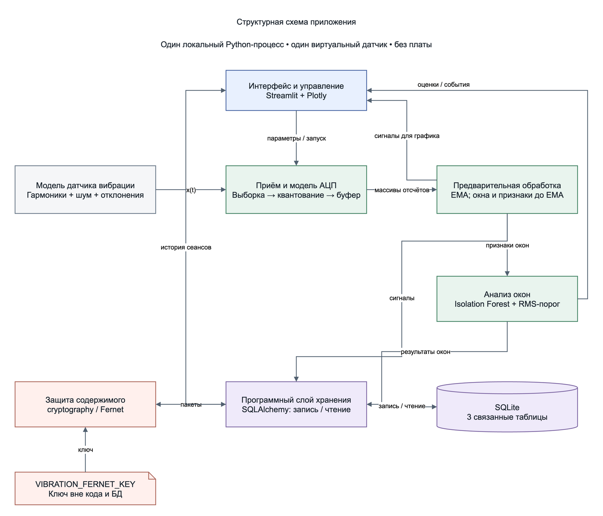
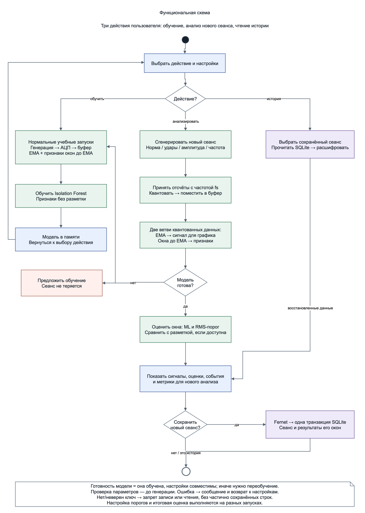
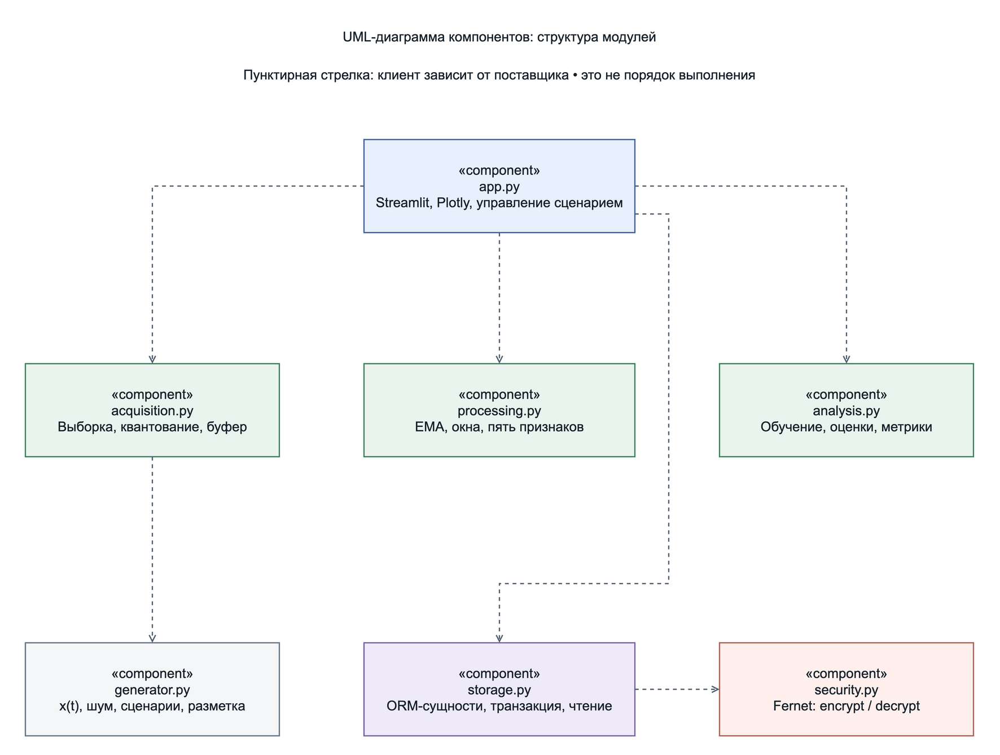
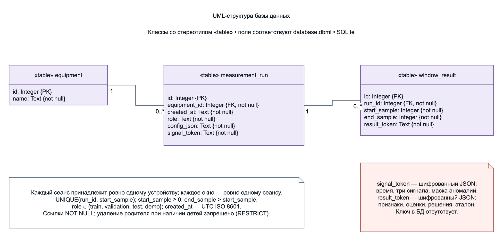

# Лабораторная работа № 1. Проект системы мониторинга вибрации

Дисциплина: «Программное и аппаратное обеспечение информационных систем».

Тема работы: применение CASE-средств для проектирования и разработки программного и аппаратного обеспечения информационных и автоматизированных систем.

Цель: определить требования, разработать схемы системы и составить план реализации.

## 1. Идея проекта

Система предназначена для анализа вибрационного сигнала виртуального оборудования. Модель формирует сумму гармоник с шумом и три вида отклонений: удары, рост амплитуды и изменение частоты.

Данные проходят выборку, квантование и буферизацию. EMA формирует сглаженный сигнал, а признаки временных окон рассчитываются до сглаживания. Isolation Forest обнаруживает аномальные окна; для сравнения используется RMS-порог. Результаты отображаются на графиках и сохраняются в SQLite с шифрованием содержимого.

Описание назначения и технологий приведено в [IDEA.md](../IDEA.md).

## 2. Технические требования

Определены 12 функциональных и восемь нефункциональных требований. Они охватывают приём и обработку данных, ML-анализ, интерфейс, хранение, защиту и обработку ошибок. Для каждого функционального требования предусмотрен критерий проверки.

Обучение, настройка порогов и итоговая оценка разделены по независимым сеансам. Модель применяется только с совместимыми настройками источника, АЦП и признаков. Ключ шифрования поступает через `VIBRATION_FERNET_KEY` и хранится отдельно от БД.

Полное описание: [REQUIREMENTS.md](REQUIREMENTS.md).

## 3. Документооборот

Документы и исходники схем размещены в [Google Drive](https://drive.google.com/drive/u/0/folders/1icmtnkUIOxuvmd44j0FU_LGCmcDVbX8p). Ссылки приведены в [перечне материалов](PUBLICATION.md).

## 4. Структурная схема

Система состоит из интерфейса, модели датчика, блока приёма и АЦП, обработки, ML-анализа, хранения и защиты. Модули работают в одном локальном Python-процессе.

## 5. Функциональная схема

Предусмотрены три действия: обучение на нормальных сеансах, анализ нового сеанса и просмотр истории. При анализе квантованные данные разделяются на ветвь EMA и ветвь оконных признаков. Запись сеанса и его результатов выполняется одной транзакцией.

## 6. UML-структура модулей

Вычислительная логика отделена от интерфейса. Компоненты представлены обычными Python-модулями.

| Модуль | Назначение |
| --- | --- |
| `app.py` | Интерфейс Streamlit, графики Plotly, управление сценарием |
| `generator.py` | Сигнал, шум, отклонения и эталонная маска |
| `acquisition.py` | Выборка, квантование и буфер |
| `processing.py` | EMA, окна и пять признаков |
| `analysis.py` | Обучение, оценки аномальности, RMS-правило и метрики |
| `storage.py` | ORM-сущности, транзакции и чтение истории |
| `security.py` | Шифрование и расшифрование Fernet |

## 7. UML-структура базы данных

Таблица `equipment` хранит сведения об оборудовании. С каждым устройством связаны сеансы `measurement_run`; каждому сеансу принадлежат результаты окон `window_result`. Обе связи имеют кратность «один ко многим».

Сигнал и результаты окон хранятся зашифрованными JSON-пакетами. Настройки, идентификаторы и границы окон остаются открытыми. Поля и ограничения описаны в [database.dbml](database.dbml).

Редактируемые схемы находятся в [diagrams.drawio](diagrams.drawio).

## 8. Этапы разработки

| Этап | Содержание |
| --- | --- |
| ЛР № 1 | Требования, схемы, структура БД и план |
| ЛР № 2 | Окружение, генератор, приём, АЦП, буфер и EMA |
| ЛР № 3 | Проверка аппаратной модели, анализ, графики и модуль защиты |
| ЛР № 4 | Физическая БД, защищённая запись, чтение и сквозная проверка |

Последовательность и зависимости описаны в [PLAN.md](PLAN.md).

## 9. Управление задачами

В [GitHub Issues](https://github.com/n3v3sl33p/vibration-monitor/issues) оформлены 12 задач T01–T12 с результатами, зависимостями и критериями готовности. Задачи распределены по четырём вехам, соответствующим лабораторным работам.

## Результат проектирования

Подготовлены требования, структурная и функциональная схемы, UML-диаграммы компонентов и базы данных, описание структуры БД и план разработки.
